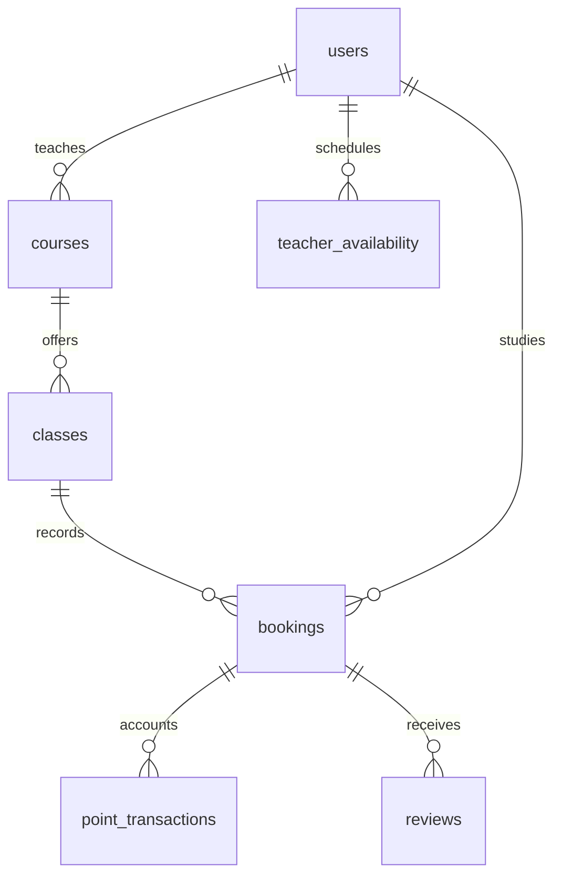

# 資料庫結構檢查與同步

## 本次已完成

實際 `yunbarter` 資料庫已套用 `002_courses_bookings_schedule.sql` 與 `003_storage_required_fields.sql`，保留原有會員、時段、預約與點數紀錄。遷移前備份位於被 Git 忽略的 `.local-backups` 目錄；遷移與後續欄位檢查不會清空資料。

原本的課程、時段與價目混在 `classes`，現在分為：

| 表 | 職責 |
|---|---|
| `courses` | 課程名稱、說明、老師、價格、上／下架狀態 |
| `teacher_availability` | 老師可授課的日期與時段，所有課程共用 |
| `classes` | 某課程在某日期時段的實際場次，保留歷史參照 |
| `bookings` | 學生預約、成交金額與名稱快照、狀態、爭議與結算時間 |
| `point_transactions` | 點數異動；新預約、撥款及退款均關聯 `booking_id` |
| `reviews` | 學生完課後的評分與評語 |

連同原有其他資料表，目前共 11 張表。`classes.price/description` 保留時段快照，新預約以 `courses.price` 定價；編輯課程不改寫既有 `bookings.points_spent/course_title`。

## 已修正的結構缺陷

- 課程內容集中存放，不再依時段或老師的單一價目推斷課程價格。
- 同一課程、日期與時段不可重複；同一學生與同一老師在相同日期／時段最多有一筆有效預約。
- 新增複合外鍵，預約老師必須符合場次擁有者，且不能預約自己的課程。
- 同一預約每種帳務異動只能寫一次，防止重複扣款、撥款與退款。
- 預約狀態必須與付款狀態配對：confirmed/disputed + escrowed、completed + released、cancelled + refunded。
- 價格及成交金額必須為正，餘額不得為負；拒絕 `NaN`、零額流水、不正確的流水正負號、錯誤時段及結束時間早於開始時間。
- 必要帳務、狀態、建立時間與評分欄位加入 `NOT NULL`；僅有 default 或 CHECK 並不能阻止 NULL。
- `classes.is_booked` 由預約觸發器維護，取消後釋放時段；保留已取消的預約歷史，不直接刪除。
- 評價加入同一預約／評價者唯一限制；帳務使用者外鍵改為限制刪除，避免刪除會員時連帶消失流水。
- 補充課程／老師、預約參與者／建立時間、點數紀錄／建立時間索引。

所有點數異動與狀態、評價使用同一筆 PostgreSQL transaction。相關會員依 ID 順序鎖定，避免多人同時操作造成超額預約或重複結算。

## 網站操作規則

1. 學生預約後，後端以課程價格扣點，建立預約與託管流水。
2. 學生可在課前取消，點數全額退回；場次重新開放，歷史不移除。
3. 課程結束後，學生確認完課與評價，後端撥點給老師並建立收入流水。
4. 開課後若有爭議，由學生提出原因，暫停結算。老師可同意全額退款，學生不能自行執行仲裁退款。
5. 已結算的預約不能再次結算；重複請求會回傳 409，其他帳號操作會回傳 403。

排班採台北時區：早上 09:00–10:00、下午 14:00–15:00、晚上 19:00–20:00。已預約時段不能移除；明確清空排班後，不會因新增課程而自動恢復。空白排班的課程仍存在，但不接受預約。

預約頁、個人頁、錢包及課程列表在操作後重新讀取資料，並在切回視窗及可見期間每 15 秒更新。編輯中的個人資料不會被輪詢覆蓋。課程發佈／編輯等待 API 確認成功後才跳頁或顯示成功；說明可保留換行、中文與 emoji。

目前同步的是 PostgreSQL 平台點數帳務；銀行付款、鏈上交易驗證與智能合約託管尚待整合。

## 實際資料檢查結果與仍會遇到的儲存問題

可在後端執行 `npm run db:audit` 重跑唯讀檢查。

| 問題 | 目前證據／影響 | 建議 |
|---|---|---|
| 期初帳不完整 | 使用者 2、3 的餘額分別比流水總額多 50、80 點，屬既有開發資料的初始餘額；只加總流水無法核帳 | 先確認期初來源，再新增明確的期初／調整紀錄。程式沒有擅自清零或補造付款紀錄 |
| 舊紀錄缺少原始資料 | 2 筆舊預約沒有建立時間；2 筆舊扣點流水沒有 `booking_id`。舊課名／姓名只能以遷移時內容補快照 | 未知建立時間保留 NULL，不偽造歷史日期；需人工確認對應後補連結。新紀錄已完整保存 |
| 後端權限過大 | 目前連線使用 `postgres` 超級使用者，程式或手動操作具備超出日常 CRUD 的權限 | 正式環境改用獨立、受限的應用帳號，將遷移帳號與執行帳號分開 |
| 大量紀錄的讀取及保存 | 錢包與預約列表目前一次讀取全部紀錄；過期 Session、舊時段與封存課程沒有定期清理工作 | 加入游標分頁、封存與保存期限，定期刪除過期 Session；資料量大時再評估分區 |
| 精度與資料交換 | PostgreSQL 使用 NUMERIC(20,6) 精確運算，但 API 顯示仍轉成 JavaScript Number | 若未來支援更大額或更小單位，金額改用十進位字串或最小單位整數傳遞 |
| 並行編輯覆蓋 | 兩個視窗同時編輯同一份個人資料／排班時，最後儲存的完整內容會覆蓋先前版本；資料列鎖不會辨識過期的表單 | 加入版本號或 updated_at 條件式更新，衝突時讓使用者重新比對內容 |
| 爭議與仲裁資料仍簡化 | 目前儲存爭議原因與退款結果，採老師同意全額退款；沒有獨立的證據、仲裁者、部分退款及決策歷程資料表 | 若要導入平台仲裁，另建爭議案件、證據與裁決稽核表，並補權限與退款金額規則 |
| 備份仍需營運流程 | 本次有遷移前備份，但沒有持續備份排程與還原演練 | 設定定期備份、異機副本、保留期限與實際還原測試 |
| 時段彈性有限 | 目前以固定三種時段判斷衝突，未支援自訂時長、跨日及任意重疊區間 | 開放任意時間前，改用時間區間及排他限制，並建立改期流程 |
| 歷史資料及刪除策略 | 為保護帳務而限制實體刪除，姓名快照也會保留 | 設計會員停用、匿名化、歷史保存與備份保留策略，避免直接在 pgAdmin 刪資料 |

本次檢查未發現負餘額、錯誤時間、未驗證限制或場次預約旗標不一致。資料庫檢查只反映執行當下；人工直接修改餘額、時段或預約狀態仍可能破壞跨表業務語意，日常異動應透過 API。

## 驗證

- `npm test`：密碼與登入存取保護。
- `npm run test:integration`：在獨立測試 schema 驗證舊資料遷移、多人隔離、內容保存、排班保存、並行預約／退款、完課撥款與評價、直接寫入的限制、重啟保存。
- `npm run build`：前端正式建置。
- 所有測試 schema 會清除；不將測試會員或測試帳務留在開發資料庫。

參考 PostgreSQL 官方文件：[資料限制](https://www.postgresql.org/docs/17/ddl-constraints.html)、[資料列鎖定](https://www.postgresql.org/docs/17/explicit-locking.html)、[部分唯一索引](https://www.postgresql.org/docs/17/indexes-partial.html)。
